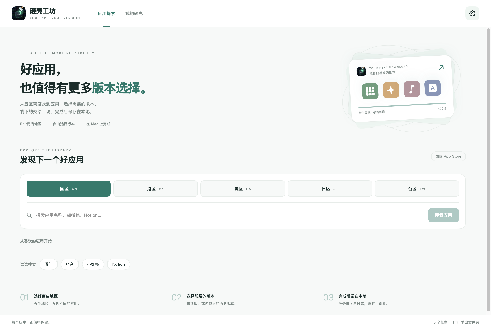

# 砸壳工坊 · macOS

原生 SwiftUI Mac 应用，支持 App Store 五区搜索、账号已有授权下载、历史版本选择、任务队列及 FairPlay 离线处理。

作者：**安桃网络**。



本仓库为 Mac 客户端源码，不包含网站、充值系统或 Linux 服务端，也不附带任何 Apple 账号、密码、登录会话、Cookie、个人解密凭据或已下载 IPA。

## 特别鸣谢

特别感谢 **Ethan Arbuckle** 开源的 **[fairplay-decrypt](https://github.com/EthanArbuckle/fairplay-decrypt)**！这个项目是本应用离线解密及凭据提取能力的重要基础。感谢作者公开研究成果和实现代码，也感谢该项目所有贡献者。

本仓库保留其原始 GPL-3.0 许可证、源码和上游版本标识。Mac 界面、任务管理、地区账号绑定及封装由本项目提供；相关基础能力归功于上游作者。

同时感谢 [majd/ipatool](https://github.com/majd/ipatool) 及其贡献者提供 App Store 下载组件。完整来源和修改说明见 [第三方组件](docs/DEPENDENCIES.md)。

## 功能

2.3 保留浅色绿调与自适应深色界面：顶部导航、五区搜索面板、应用卡片、右侧版本详情及独立任务页面。

- 国区、美区、日区、港区、台区搜索与独立下载会话。
- 最新版本下载、历史版本查询与选择；历史版本是否可下载由 Apple 和账号授权决定。
- 免费应用取得许可，付费应用仅使用账号已有购买授权。
- 各地区下载账号与对应离线凭据绑定并保存。
- 多任务并行、下载进度、独立任务详情、完整日志复制。
- 自动核对 IPA 内 Mach-O 的加密标记，并按软件名、版本号和校验结果命名。
- 手机连接时提供设备相关功能；具备匹配凭据后，普通 IPA 的离线处理无需持续连接手机。

“全解密”表示包内所检查的加密项已通过校验，不等于重新签名或额外系统权限。运行能力仍取决于应用、架构、授权类型和 Apple 返回结果。

## 环境

- 完整安装包面向 **Apple Silicon Mac、macOS 15 或更新版本**。客户端及随包原生依赖的部署目标均不高于 macOS 15；暂不提供 Intel 包。当前验证机器为 macOS 27，尚未在真实 macOS 15 设备上验收。
- 完整 Xcode（包含 iPhoneOS SDK）、Xcode 命令行工具。
- Python 3.10+、Go 1.25+、Homebrew。
- 设备端凭据提取需要兼容的越狱 iPhone 和可用的 USB SSH；下载与解密所用账号必须匹配。

## 从源码构建

```bash
brew install python go ldid autoconf automake libtool pkgconf cmake
python3 scripts/check_public_source.py
bash scripts/prepare_dependencies.sh
bash build_app.sh ./outputs
```

首次准备依赖会按锁定来源及 SHA256 构建 macOS 15 原生设备库、OpenSSL 和 Python，再准备官方 ipatool、地区下载组件、Python 独立助手和设备辅助程序。需要网络和较长编译时间。构建不会读取或导出已安装应用的账号数据。

`scripts/macos15-sources.json` 记录原生依赖来源及哈希；打包时会同时检查外层程序和内嵌 Python 的最低系统版本，阻止误用高版本 Homebrew 运行库。

产物位于 `outputs/砸壳工坊.app`，可拖入“应用程序”。本地构建使用临时签名，未做 Developer ID 签名和 Apple 公证。源码编译成功不代表各地区在线登录、下载和解密已经在当前机器上验收。

需要拖拽式 DMG 安装镜像时，在依赖就绪后运行 `bash scripts/package_dmg.sh`。默认产物为 `outputs/砸壳工坊-2.3-macOS15-arm64.dmg`，含应用、“应用程序”快捷入口、账号初始化脚本、使用说明和开源致谢。

只有桌面代码开发需求时，可以直接运行 `swift build -c release`；完整下载/设备流程仍需上述辅助组件。更换已安装下载组件可能重新触发钥匙串授权。

## 配置自己的账号

安装后运行 `outputs/初始化下载会话.command`，选择地区并在本机完成登录；随后按 [使用说明](docs/使用说明.md) 提取同账号凭据，在设置里绑定并保存。

完整安装包内置供下载和离线处理使用的 Python 运行时，不要求接收者安装 Homebrew 或 Python。可选的 Frida 手机运行时路径仍使用“设置 → 环境”里的单独环境，需要相应设备与组件。

账号会话保存在本机钥匙串，应用状态通常位于 `~/Library/Application Support/DumpShop/`。这些内容不属于仓库，不能随源码上传。账号密码与验证码只在本机输入。

## 测试

```bash
python3 -m venv .venv
.venv/bin/python -m pip install 'cryptography>=41'
.venv/bin/python -m unittest discover -s engine -p 'test_*.py'
swift build -c release
.build/release/DumpShop --selftest check --source-only
```

这些检查覆盖离线逻辑和构建，不使用真实账号，也不会进行实际购买。`--source-only` 明确跳过未随源码分发的助手打包检查；准备完全部依赖后，可以去掉该参数执行完整自检。

## 上传 GitHub

本目录已经剔除旧 Git 历史和本机产物。请在 GitHub 创建空仓库，然后在本目录执行以下命令，将最后一行地址换成自己的仓库：

```bash
python3 scripts/check_public_source.py
git init
git add .
git diff --cached --stat
git commit -m "Initial macOS source release"
git branch -M main
git remote add origin https://github.com/YOUR_NAME/YOUR_REPO.git
git push -u origin main
```

后续提交前也应检查暂存内容；`.gitignore` 无法清除已经进入 Git 历史的秘密。此目录没有复制原项目 Git 历史。

## 目录

| 位置 | 内容 |
| --- | --- |
| `Sources/DumpShop/` | SwiftUI 客户端 |
| `engine/` | 下载、设备操作、包校验及离线测试 |
| `assets/` | 应用图标 |
| `scripts/` | 依赖准备、发布检查、会话初始化脚本 |
| `vendor/fairplay-decrypt/` | 带许可证的上游源码及本项目适配 |
| `vendor/ipatool/` | 带许可证的下载组件源码及地区/TLS 适配 |
| `docs/` | 使用、依赖与公开发布说明 |

## 许可证

本项目采用 [GPL-3.0](LICENSE)，Copyright © 2026 安桃网络。第三方代码保留各自许可证和版权声明，详情见 [DEPENDENCIES.md](docs/DEPENDENCIES.md)。
